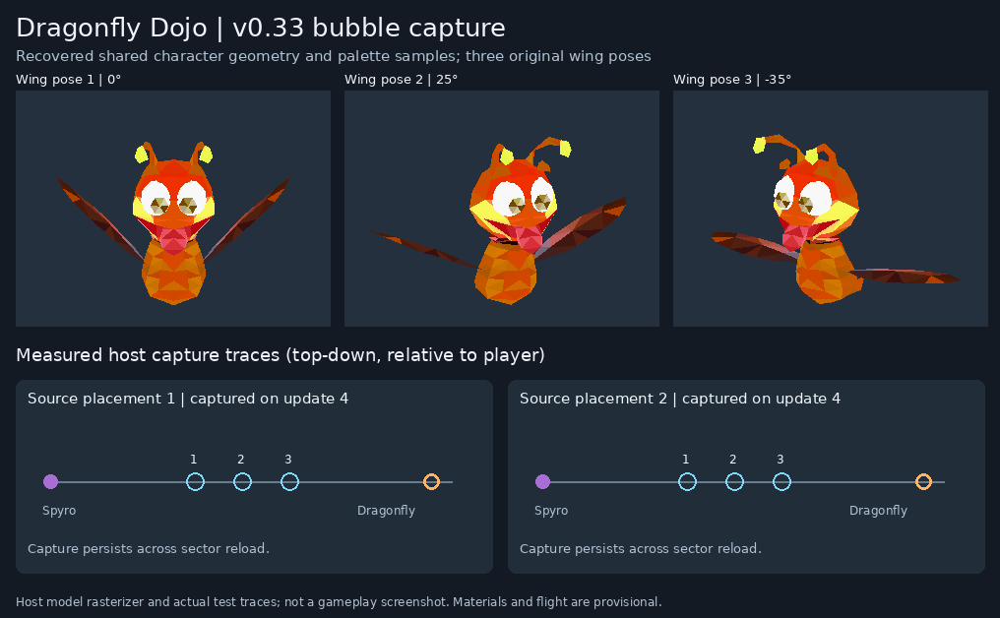

# Spyro: Enter the Dragonfly — PS1 demake / expanded vision

**Work in progress — experimental native PlayStation prototype.**

Unofficial fan development project targeting the original PlayStation (MIPS R3000A, GTE, 2 MiB main RAM, 1 MiB VRAM, 512 KiB SPU RAM). Classic Mode aims to reconstruct the released adventure; Expanded Mode aims to explore the originally ambitious vision with separately labeled new designs.

## v0.33 — Bubble breath and dragonfly capture

*Source-derived model render and actual host test traces, not an emulator screenshot.*

- Two source-positioned Dojo dragonflies capturable via reconstructed bubble breath; two scripted placements reserved.
- Original shared body and wing poses, provisional red-orange palette binding.
- Persistent session capture ledger, 90 Classic and 120 Expanded slots; 26 adventure levels, 4 homeworlds and 5 boss encounters in the [proposed campaign registry](campaign33.json).
- Native MIPS-I compilation, six new host tests and 24 distinct inherited tests passed.
- Linked RAM 1,723,600 bytes; 176,944 bytes before reserved stack.

Triangle selects fire/bubble; Circle breathes; R2+Start toggles the mode and resets the diagnostic session. Both modes currently share the Dojo prototype. Expanded content and boss battles are not implemented. The percentage is a shared-engine estimate, not playable campaign completion. Emulator boot and real hardware operation remain unverified.

## Source checkpoint

See [v0.33 technical notes](milestones/v0.33/TECHNICAL.md), [memory report](milestones/v0.33/report33.json), [archive checksums](milestones/v0.33/ARCHIVES.md), [host capture trace](milestones/v0.33/capture_trace.json) and [historical milestones](milestones/history). The [v0.32 notes](milestones/v0.32/TECHNICAL.md) describe boot-bank optimization.

This is a source archive, **not a standalone buildable checkout**. Generated asset banks, intermediate builds, executables and disc images remain separate. Build with the locally converted assets; the original PS2 ISO and extracted proprietary asset banks are not committed.

## Next work

Scripted captures, NPCs, portal transitions, additional breaths and the released Ripto fight. Then build separate expanded content packs for cancelled-level concepts and new fan-designed levels and boss encounters. No claim that the planned expansion reproduces undocumented original designs.

Spyro and Enter the Dragonfly belong to their respective rights holders. This independent project is not affiliated with them.
