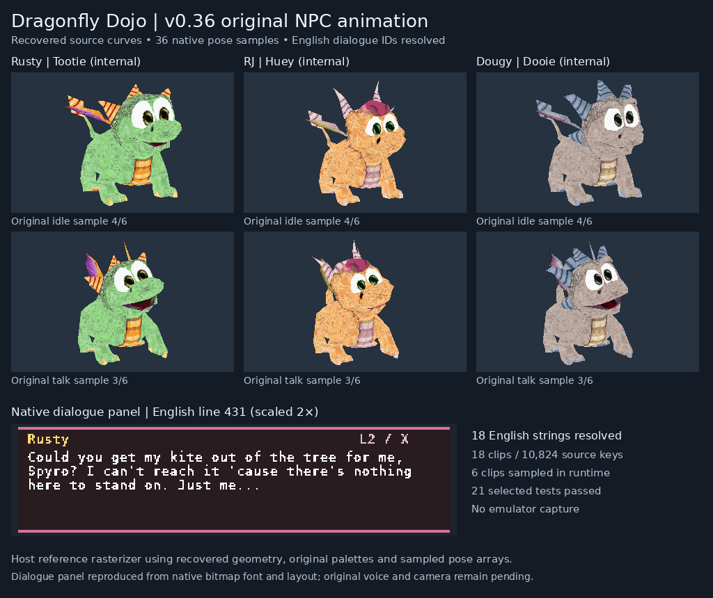

# Spyro: Enter the Dragonfly — PS1 demake / expanded vision

**Work in progress — experimental native PlayStation prototype.**

Unofficial fan development project targeting the original PlayStation (MIPS R3000A, GTE, 2 MiB main RAM, 1 MiB VRAM, 512 KiB SPU RAM). Classic Mode aims to reconstruct the released adventure; Expanded Mode explores the originally ambitious vision with separately labeled new designs.

## v0.36 — Original NPC animation and English dialogue

*Host reference rasterization, not an emulator screenshot.*

- Three original baby dragons: Rusty (Tootie internally), RJ (Huey), Dougy (Dooie).
- 18 matched original animation clips, 10,824 source keyframes, 30 joints per model. Six idle/talk clips sampled into 36 poses for native playback.
- 18 English dialogue and name strings resolved from the TITLE language table, with quest-dependent branching.
- L2 opens dialogue; L2/Cross advances; gameplay simulation pauses while the panel is active.
- Native MIPS-I compilation passed; 1,866,352 bytes linked RAM, 34,192 bytes before reserved stack.
- 21 selected distinct tests passed, including inherited capture and all twelve quest order/mode scenarios.
- 90 Classic / 120 Expanded ledger slots; [proposed campaign registry](campaign33.json) contains 26 adventure levels, four homeworlds and five boss encounters.

Both modes share the current Dojo prototype. Animation interpolation, font, UI, and interaction timing are adapted; kite animation, original voice and camera, additional breath abilities and exact environmental puzzle triggers remain pending. Expanded content is not implemented. The progress percentage is a shared-engine engineering estimate, not playable campaign completion. Emulator and physical hardware execution remain unverified.

## Source checkpoint

See [technical notes](milestones/v0.36/TECHNICAL.md), [animation report](milestones/v0.36/animation_report.json), [dialogue mapping](milestones/v0.36/dialogue_mapping36.json), [memory report](milestones/v0.36/report36.json), [test results](milestones/v0.36/test_results.txt), [archive checksums](milestones/v0.36/ARCHIVES.md) and [historical milestones](milestones/history).

This is a source archive, not a standalone buildable checkout. Generated proprietary asset banks, intermediate builds, executables and disc images remain separate. Build with locally converted assets and the local PS2 source disc.

## Next work

Animation memory optimization, original voice and kite animation, exact quest triggers and additional breaths, portal transitions, the released Ripto fight, and separately identified expanded content packs.

Spyro and Enter the Dragonfly belong to their respective rights holders. This independent project is not affiliated with them.
