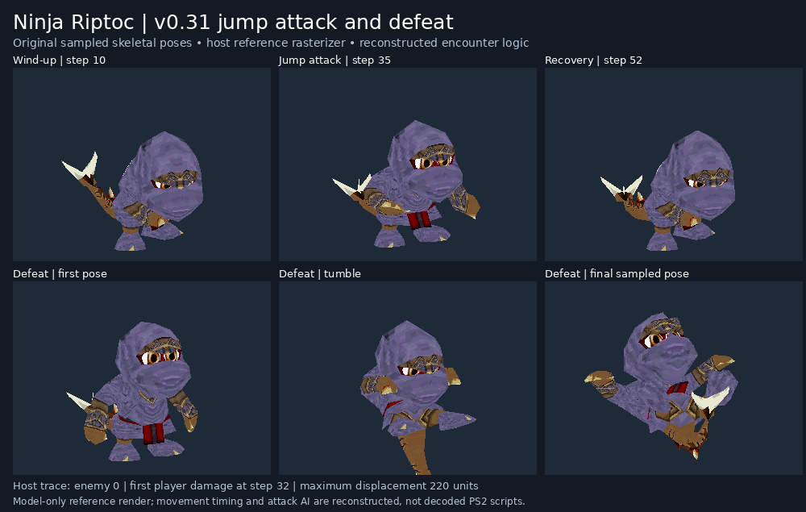

# Spyro: Enter the Dragonfly — PS1 demake

**Work in progress — experimental native PlayStation prototype.**

This unofficial fan development project targets the original PlayStation (MIPS R3000A, GTE, 2 MiB main RAM, 1 MiB VRAM, 512 KiB SPU RAM). The goal is to reconstruct the adventure using a native fixed-point engine and locally converted assets.

## Current milestone: v0.31 — Animated Ninja Riptoc combat

*Software-rendered diagnostic of recovered model and animation poses; not an emulator screenshot.*

- Dragon Realms and Dragonfly Dojo terrain and texture streaming.
- Source-positioned gems, baskets and Ninja Riptocs.
- Original sky environment and sampled character animations.
- Reconstructed enemy detection, windup, jump attack, recovery and persistent defeat.
- Native MIPS-I compilation and 18 recorded host regression tests passed.
- Approximately 1.77 MiB linked main RAM; 42.5 KiB before the reserved stack.

The percentage is an engineering estimate, not the percentage of playable original content. Emulator boot, real hardware operation, performance and complete adventure progression remain unverified.

## Source checkpoint

This repository preserves 232 files from the development workspace, including native engine source, conversion and build tools, host regression tests and latest integration source. The historical development notes are in [milestones/history](milestones/history), and [v0.31 technical notes](milestones/v0.31/TECHNICAL.md) document the latest behavior and build workflow.

This is a source archive, **not yet a complete standalone buildable checkout**. Generated asset banks, intermediate builds, PS1 executables and disc images are retained separately. See the [archive manifest](milestones/v0.31/ARCHIVES.md) for exact SHA-256 checksums. The original PS2 ISO and extracted proprietary game assets are not committed.

## Next work

Memory optimization, additional NPCs, dragonfly capture, bubble breath, portal transitions and emulator verification.

Spyro and Enter the Dragonfly belong to their respective rights holders. This independent project is not affiliated with them.
