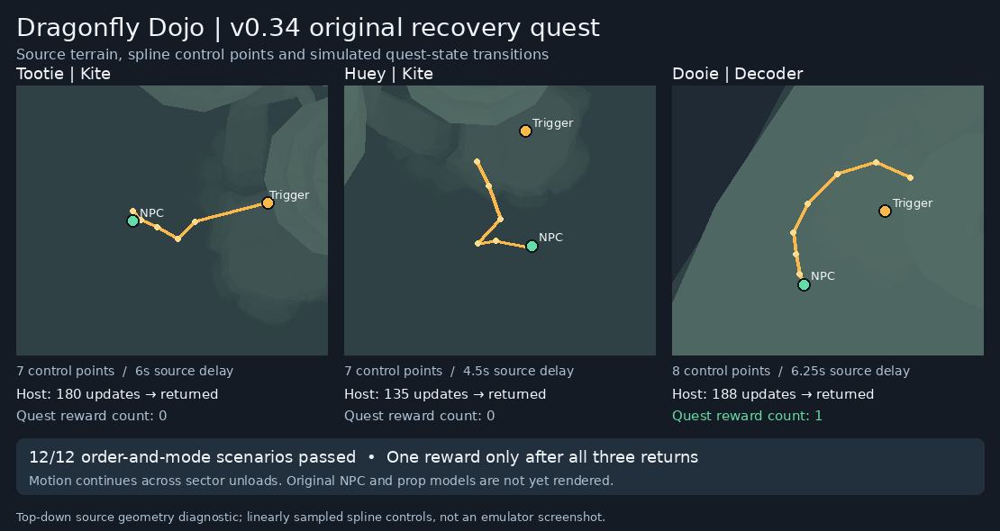

# Spyro: Enter the Dragonfly — PS1 demake / expanded vision

**Work in progress — experimental native PlayStation prototype.**

Unofficial fan development project targeting the original PlayStation (MIPS R3000A, GTE, 2 MiB main RAM, 1 MiB VRAM, 512 KiB SPU RAM). Classic Mode aims to reconstruct the released adventure; Expanded Mode explores the originally ambitious vision with separately labeled new designs.

## v0.34 — Source-derived Dojo recovery quest

*Top-down recovered geometry and quest path diagnostic, not an emulator screenshot.*

- Tootie, Huey and Dooie: three source-script recovery dependencies and one shared dragonfly award.
- Nine original placement IDs, 22 spline control points, source motion delays of 6, 4.5 and 6.25 seconds.
- All twelve completion order/mode scenarios passed; four new and six inherited host tests passed.
- Native MIPS-I compilation passed; 1,728,848 bytes linked RAM, 171,696 bytes before reserved stack.
- Two free-roaming Dojo bubble captures preserved. The Tootie DFLY record is a kite prop, not an independent free capture.
- 90 Classic / 120 Expanded ledger slots; [proposed campaign registry](campaign33.json) contains 26 adventure levels, four homeworlds and five boss encounters.

Triangle selects fire/bubble; Circle breathes; L2 interacts near an NPC marker; R2+Start toggles the mode and resets the diagnostic session. Both modes share the Dojo prototype. Quest paths use linear interpolation and diagnostic markers; original NPC models, prop models, camera and dialogue are pending. Expanded bosses and levels are not implemented. The percentage is a shared-engine estimate, not playable campaign completion. Emulator boot and real hardware operation remain unverified.

## Source checkpoint

See [technical notes](milestones/v0.34/TECHNICAL.md), [source quest mapping](milestones/v0.34/quest_report.json), [memory report](milestones/v0.34/report34.json), [test results](milestones/v0.34/test_results.txt), [archive checksums](milestones/v0.34/ARCHIVES.md) and [historical milestones](milestones/history). Previous [v0.33 notes](milestones/v0.33/TECHNICAL.md) document bubble capture.

This is a source archive, not a standalone buildable checkout. Generated asset banks, intermediate builds, executables and disc images remain separate. Build with locally converted assets; the original PS2 ISO and extracted proprietary asset banks are not committed.

## Next work

Original NPC and prop model recovery, quest dialogue and cameras, portal transitions, additional breaths, the released Ripto fight and expanded content packs.

Spyro and Enter the Dragonfly belong to their respective rights holders. This independent project is not affiliated with them.
