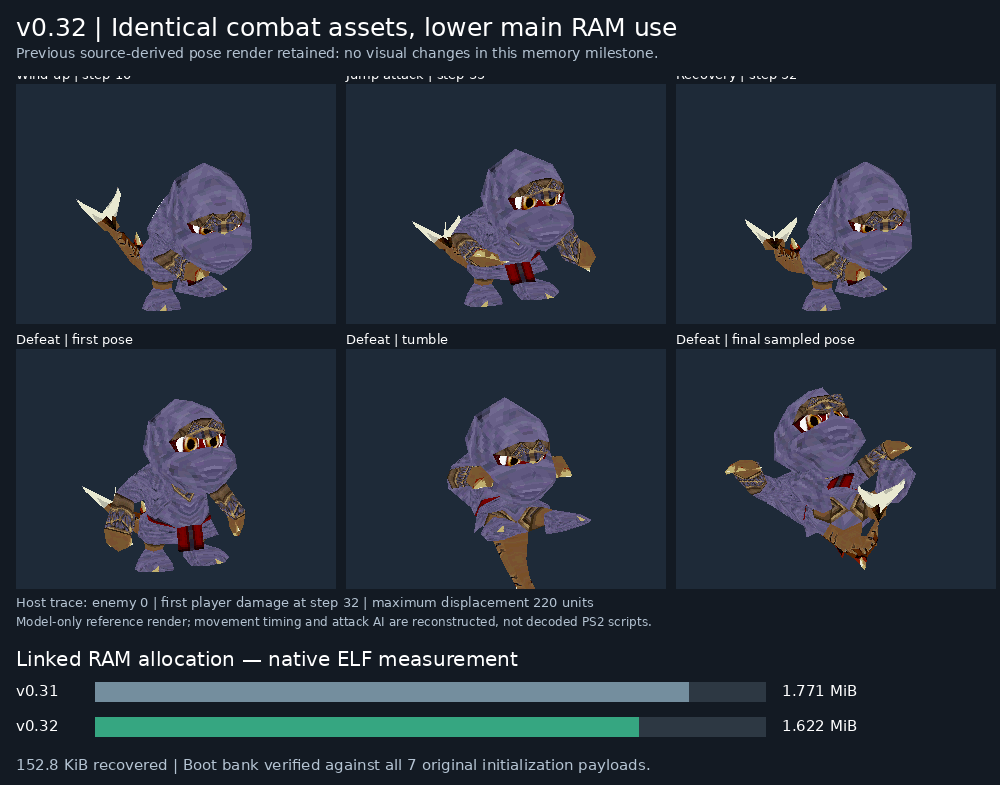

# Spyro: Enter the Dragonfly — PS1 demake

**Work in progress — experimental native PlayStation prototype.**

Unofficial fan development project targeting the original PlayStation (MIPS R3000A, GTE, 2 MiB main RAM, 1 MiB VRAM, 512 KiB SPU RAM). The goal is to reconstruct the adventure using a native fixed-point engine and locally converted assets.

## Current milestone: v0.32 — Boot asset streaming and RAM optimization

*Source-derived model/animation preview carried forward from v0.31; no graphical changes in this revision. Not an emulator screenshot.*

- 152.8 KiB net linked RAM recovered by moving seven initialization-only GPU/SPU payloads to a CRC-validated CD boot bank.
- 195.3 KiB available before the reserved stack, compared with 42.5 KiB in v0.31.
- All seven payloads preserved byte-for-byte; no new geometry, texture or animation cuts.
- Native MIPS-I compilation, six new host tests and 18 distinct inherited tests passed.
- Dragon Realms and Dragonfly Dojo terrain/texture streaming, collectible objects, skybox, animated Ninja Riptoc encounters and combat carried forward.

The percentage is an engineering estimate, not the percentage of playable original content. Emulator boot, real hardware operation, performance and complete adventure progression remain unverified.

## Source checkpoint

See [v0.32 technical notes](milestones/v0.32/TECHNICAL.md), [memory report](milestones/v0.32/report32.json), [archive manifest](milestones/v0.32/ARCHIVES.md) and [historical milestones](milestones/history). Previous [v0.31 notes](milestones/v0.31/TECHNICAL.md) remain available.

This is a source archive, **not yet a standalone buildable checkout**. Generated asset banks, intermediate builds, executables and disc images remain separate; the original PS2 ISO and extracted proprietary assets are not committed. Build from the full local workspace with the matching converted assets.

## Next work

Dragonfly capture, bubble breath, NPCs, portal transitions, additional levels and emulator verification.

Spyro and Enter the Dragonfly belong to their respective rights holders. This independent project is not affiliated with them.
