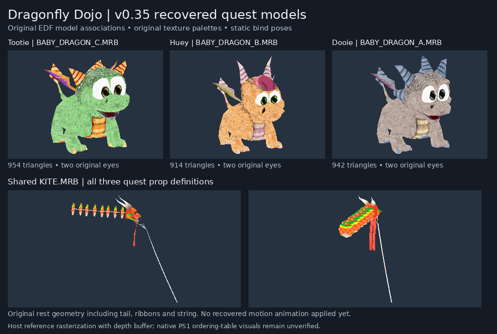

# Spyro: Enter the Dragonfly — PS1 demake / expanded vision

**Work in progress — experimental native PlayStation prototype.**

Unofficial fan development project targeting the original PlayStation (MIPS R3000A, GTE, 2 MiB main RAM, 1 MiB VRAM, 512 KiB SPU RAM). Classic Mode aims to reconstruct the released adventure; Expanded Mode explores the originally ambitious vision with separately labeled new designs.

## v0.35 — Original Dojo quest models

*Host reference rasterization of recovered models and texture palettes, not an emulator screenshot.*

- Original Tootie, Huey and Dooie model associations and shared dragon kite, replacing diagnostic world markers.
- Four recovered model resources, 4,472 source triangles, 3,571 retained, eleven original texture groups and six original eyes.
- CRC-validated 50,688-byte texture boot bank; nonoverlapping VRAM allocations.
- Native MIPS-I compilation passed; 1,805,088 bytes linked RAM, 95,456 bytes before reserved stack.
- Five new and ten inherited tests passed; all twelve quest order/mode scenarios still pass.
- 90 Classic / 120 Expanded ledger slots; [proposed campaign registry](campaign33.json) contains 26 adventure levels, four homeworlds and five boss encounters.

Triangle selects fire/bubble; Circle breathes; L2 interacts near an NPC; R2+Start toggles mode and resets the diagnostic session. Both modes share the Dojo prototype. NPC static bind poses, facing and kite orientation are provisional; animation, dialogue, original cutscene camera and PS2 shader behavior remain unfinished. Expanded bosses and levels are not implemented. The percentage is a shared-engine estimate, not playable campaign completion. Emulator and hardware execution remain unverified.

## Source checkpoint

See [technical notes](milestones/v0.35/TECHNICAL.md), [model report](milestones/v0.35/model_report.json), [memory report](milestones/v0.35/report35.json), [test results](milestones/v0.35/test_results.txt), [archive checksums](milestones/v0.35/ARCHIVES.md) and [historical milestones](milestones/history).

This is a source archive, not a standalone buildable checkout. Generated asset banks, intermediate builds, executables and disc images remain separate. Build with locally converted assets; the original PS2 ISO and extracted proprietary asset banks are not committed.

## Next work

Original NPC and kite animation, quest dialogue and cameras, portal transitions, additional breaths, released Ripto fight, and expanded content packs.

Spyro and Enter the Dragonfly belong to their respective rights holders. This independent project is not affiliated with them.
