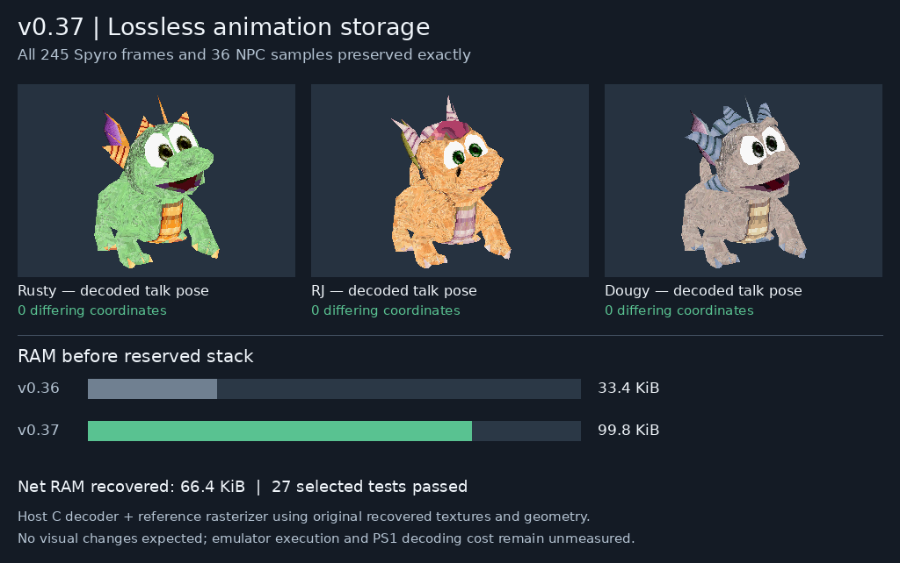

# Visual reference for v0.45

Archived host-rendered preview of the original recovered NPC geometry, textures and decoded poses. This is the authentic adventure baseline. v0.45 adds asset/audio intake checks only, so there is no new in-game frame or emulator screenshot for this milestone. The temporary v0.44 asset lab is not the visual target.
